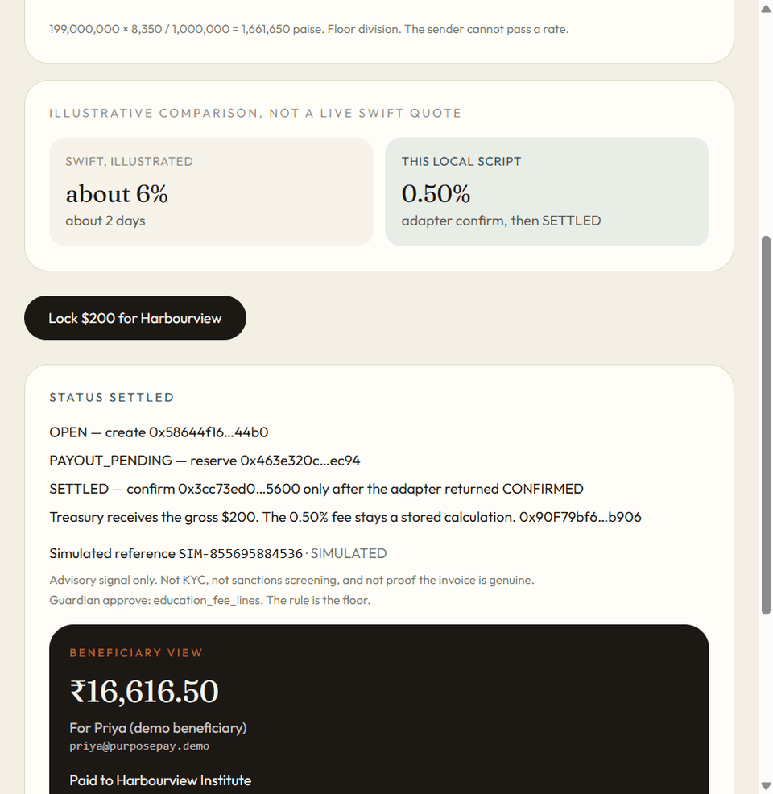

# PurposePay



Programmable, compliant cross-border remittances. A sender locks tokenized USD for tuition. On settlement the vault releases that gross USD to a treasury address. INR can be paid only to the school that sender approved. The beneficiary does not need a wallet.

**Tracks:** cross-border remittances and financial inclusion. UPI is the intended settlement rail. This demo's rail response is simulated unless `DRUNIX_SANDBOX_URL` is set.

## Run

Requires Node.js 20 or newer. No `.env` file. `npm run demo` creates `rail/data/payouts.json` and `deployments/local.json`. The audit CSV is generated by the relayer and is not stored in the repo.

```bash
npm install
npm run demo
```

Open http://127.0.0.1:3000/send

`npm test` runs the contract tests, the idempotency test, the Guardian floor tests, and the relayer kill-and-resume test.

## Allowed claims

- The FX quote is owner-set. The sender cannot pass a rate.
- `createRemittance` rejects an unregistered payee and a hospital-on-tuition payee in a reverting transaction, before tokens move.
- `reservePayout` and `confirmPayout` take no payee and no amount.
- `confirmPayout` sends the converted principal (`$199`) to the treasury and the fee (`$1`) to the fee account. The INR credit uses the `$199` only.
- The payment reference is simulated (`referenceType: SIMULATED`).
- Family-funded tuition ships as product tag `TUITION` with demo purpose code `P1301`.

## Disallowed claims

- Do not say NPCI, a bank, or Drunix settled the payment.
- Do not call the simulated reference an NPCI or bank RRN.
- Do not describe the payee hash as anonymity, or the HMAC party ref as KYC.
- Do not present Guardian as sanctions screening or proof the invoice is genuine.
- Do not present the SWIFT column as a live quote.
- Do not present "under 10 seconds" as a production SLA.

## Known limitations

- `SETTLED` is a local relayer attestation that the adapter returned `CONFIRMED`. The contract does not independently verify the rail. A compromised relayer could attest to a payment that did not happen. This is a demonstration of the workflow, not a trustless cross-border settlement protocol. A bank-grade design would need an authenticated, independently verifiable confirmation and reconciliation with the rail.
- Funds in `PAYOUT_PENDING` or `PAYOUT_UNKNOWN` depend on relayer liveness. A relayer that stays down leaves those dollars in the vault. There is no time-based refund, because a late credit would double-pay.
- A definite reject becomes `PAYOUT_REJECTED`. The sender can refund the gross, because the adapter reported that no credit was created. That refund is also a relayer attestation. `PAYOUT_UNKNOWN` cannot be refunded.
- `DrunixSandbox` is unconnected unless `DRUNIX_SANDBOX_URL` is set. The default rail is `MockUPI`.
- The reference is simulated. It is stored in `rail/data/payouts.json`, not in the chain event. That file is a single-process demo store, not a durable concurrency-safe ledger.
- The HMAC key defaults to a local demo value. If the key changes, the same VPA gets a new party ref. If the key is exposed, the pseudonym is weakened. Production would need protected key management, durable transactional storage, and controlled access to the relayer.
- "Under 10 seconds" applies only to this local script, from lock through the adapter confirm on localhost. It is not a network SLA.

## Tests

Re-run on 29 Sep 2026 after the fee split and the reject refund, on Node 24.

| Suite | Result |
| --- | --- |
| PurposeVault (Hardhat) | 14 passing |
| MockUPI idempotency, including one concurrent payout id and a retry | 3 passing |
| Guardian floor | 3 passing |
| Relayer kill-and-resume | 1 passing |
| **Total** | **21 passing, 0 failing** |

The settlement test checks that the vault drops by $200, the treasury gains $199, and the fee account gains $1. A second confirm does not move funds again. A failed confirm can be retried. A removed payee fails reserve. An expired quote cannot create a remittance. Refund and reserve cannot both succeed. A definite reject can be refunded. A `PAYOUT_UNKNOWN` row cannot.

## What is live

| Piece | This demo |
| --- | --- |
| Asset escrow | Local Hardhat chain. `MockUSD` and `PurposeVault`. |
| FX quote | Owner-set on the contract. Seed rate ₹83.50, fee 50 bps. |
| USD release | On `SETTLED`, `$199` goes to the treasury and `$1` goes to the fee account. |
| Payout rail | `MockUPI`, unless `DRUNIX_SANDBOX_URL` is set. |
| Payment reference | `referenceType: SIMULATED`. Not an NPCI or bank RRN. |
| Guardian | Deterministic rule on labeled notice fields. An API key turns on extraction only. |

## Fee

The sender does not supply a rate. `createRemittance` reads `setQuote` and stores gross, fee, and net. Rounding is floor division. On `SETTLED` the fee is retained by the fee account and the net principal is what the treasury receives. The INR credit uses the net only.

- Gross locked `$200.00` = `200_000_000`
- Fee retained by the fee account `0.50%` = `1_000_000` (`$1.00`)
- Converted principal sent to the treasury `$199.00` = `199_000_000`
- Rate `8350` paise per USD
- Beneficiary credit `199_000_000 × 8350 / 1_000_000` = `1_661_650` paise = **₹16,616.50**

Reconciliation: `$200` locked = `$1` fee + `$199` converted. The rupee amount is the INR equivalent of the `$199`, not of the `$200`.

The SWIFT "about 6%, about 2 days" column is an illustration. It is not a quote.

## What the contract enforces

`createRemittance` checks the payee before it takes tokens:

- `friend@purposepay.demo` reverts `UnregisteredPayee`
- Citycare Clinic on tuition reverts `CategoryMismatch`

`reservePayout` and `confirmPayout` take no payee and no amount. Northgate Academy is a registered school the sender did not approve. That failure is a **policy preview (view call)**, labeled as such. No payout function accepts a payee.

States: `OPEN` → `PAYOUT_PENDING` → `SETTLED`, and `PAYOUT_PENDING` → `PAYOUT_UNKNOWN` when the rail times out. `PAYOUT_PENDING` or `PAYOUT_UNKNOWN` → `PAYOUT_REJECTED` when the adapter returns `DEFINITE_REJECT`, and the sender can then refund the gross. `SETTLED` is written only after the adapter returns `CONFIRMED`. That confirm sends `netUsd6` to the treasury and `feeUsd6` to the fee account. The same payout id is stored in `rail/data/payouts.json` before the adapter returns, so a restart does not create a second credit.

## Purpose code

`purposeTag` is `TUITION`. `purposeCode` is a **demo mapping**, not a filing instruction.

P1107 and P1108 describe educational and health services non-residents receive from Indian institutions. P1301 is an inward remittance from non-residents for family maintenance and savings. Family-funded tuition may be reported as P1301. This build ships **P1301** with the tag **TUITION** until a Citi mentor says otherwise.

## Guardian

Advisory signal only. Not KYC, not sanctions screening, and not proof the invoice is genuine.

The model, when `ANTHROPIC_API_KEY` is set, extracts fields from the raw notice and writes reasons. It cannot turn a hold into an approve. The rule is the floor: for `TUITION`, there must be at least one line item and every line-item category must be `EDUCATION_FEE`. The word "tuition" in the text does not pass.

Offline results on the six seeded notices:

1. Harbourview semester fee — approve — `education_fee_lines`
2. Electronics bundle labeled tuition — hold — `line_item_category_mismatch`
3. Semester fee plus gadget — hold — `line_item_category_mismatch`
4. Bookstore textbooks — hold — `line_item_category_mismatch`
5. Empty notice — hold — `line_item_category_mismatch`
6. Northgate term fee — approve — `education_fee_lines`

Quote and compliance are modules, not agents. There is no accuracy percentage.

## Audit file

`/audit` exports CSV. Party columns are `HMAC-SHA256(AUDIT_HMAC_KEY, "vpa:" + vpa)`. The file has no raw VPA, name, or notice text. It is a demo extract, not a regulatory filing. The default key is local-only and is overridden by `AUDIT_HMAC_KEY` when that variable is set. Changing the key changes the party refs. The CSV columns `grossUsd6`, `feeUsd6`, and `netUsd6` are the locked amount, the fee retained by the fee account, and the principal converted to INR.

## Parties

Fictional. No real institution and no real bank handle.

- Sender `arun@purposepay.demo`
- Beneficiary `priya@purposepay.demo`
- Approved school: Harbourview Institute, `fees@harbourview.demo`
- Other school, view only: Northgate Academy
- Hospital: Citycare Clinic
- Unregistered: `friend@purposepay.demo`
